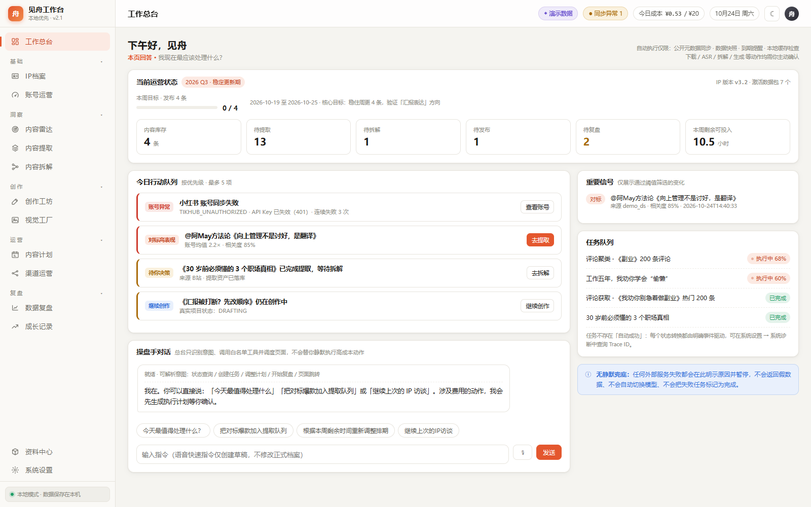
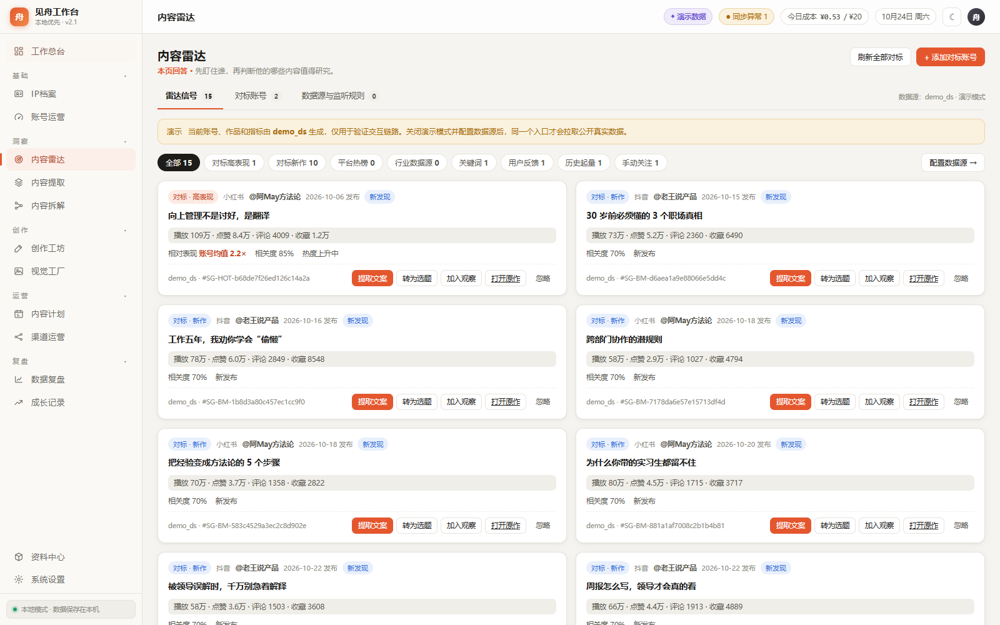
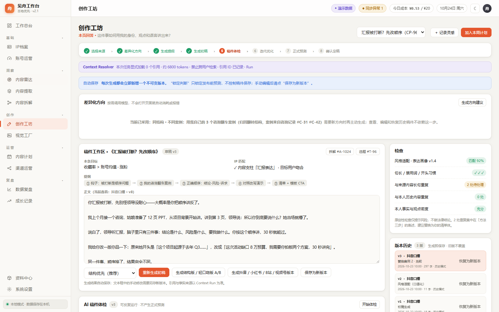
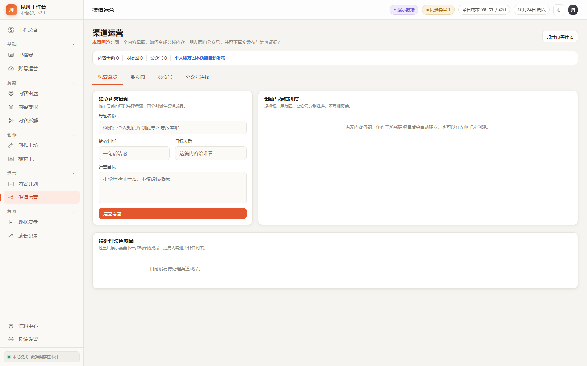

<div align="center">

# 见舟 · 自媒体运营工作台

**把 IP 定位、选题、创作、视觉制作、渠道运营与数据复盘，放进一个本地工作台。**

面向个人创作者、知识型 IP 和小型内容团队的 AI 辅助运营工具。

Python 3.11+ · FastAPI · SQLite · Vue 3 · 本地优先

[功能介绍](#功能介绍) · [界面预览](#界面预览) · [快速开始](#快速开始) · [配置真实服务](#配置真实服务) · [联系见舟](#联系见舟)

</div>



> 当前源码版本为 **v2.1.0**。上图及下方截图均来自隔离的演示工作区，账号、内容和指标为演示数据。

## 为什么做这个工作台

做内容的日常工作，往往散落在表格、笔记、聊天窗口和不同平台后台：选题放在一个地方，稿件存在另一个地方，发布后又很难找到当时的判断。

见舟工作台围绕「内容母题」串起这些工作。同一个想法可以形成短视频稿、封面、图文、朋友圈和公众号文章；每个成品保留自己的版本、排期、发布记录和复盘，之后还能回到资料中心继续复用。

工作台在本机运行，业务数据保存在本地。使用真实数据采集、AI 写作、语音转写或图片生成时，会按所选服务调用外部 API。

## 功能介绍

| 模块 | 可以做什么 |
| --- | --- |
| 工作总台 | 汇总运营周期、内容库存、今日行动、重要信号与任务进度 |
| IP 档案 | 通过访谈和资料整理定位、受众、内容支柱与表达风格，保存和切换画像版本 |
| 账号运营 | 管理自己的账号、同步作品与指标、查看运营周期，把作品转入提取流程 |
| 内容雷达 | 管理对标账号、浏览作品、跟踪热点与行业数据源，把信号转为选题或提取任务 |
| 内容提取与拆解 | 从文件或平台作品提取内容，进行音频转写、结构分析和模式整理，保留来源关系 |
| 创作工坊 | 记录灵感，选择差异化方向，生成提纲和多平台稿件，进行稿件体检、迭代优化与发布前判断 |
| 视觉工厂 | 管理人物与品牌素材、模板和提示词，制作封面、图文文档与长图，保留批次和历史版本 |
| 内容计划 | 用看板和周计划管理选题、写作、制作、待发布及待复盘任务 |
| 渠道运营 | 围绕同一母题派生朋友圈与公众号文章，支持编辑、配图关联、排期和发布登记 |
| 数据复盘与成长记录 | 记录 T+1 / T+3 / T+7 等指标快照，对照发布前判断复盘，积累可审核的经验规则 |
| 资料中心 | 统一检索素材、稿件、视觉成品、渠道内容和复盘，管理收藏与集合 |
| 系统设置 | 配置运行模式、数据源、文本/语音/图片模型、公众号、成本预算与诊断 |

### 一条典型工作流

```text
IP 档案 + 自有账号
        ↓
个人灵感 / 对标作品 / 热点信号
        ↓
内容提取 → 内容拆解 → 差异化方向 → 提纲与稿件
                                      ↓
                          稿件体检 → 优化 → 确认定稿
                                      ↓
                     封面 / 图文 / 朋友圈 / 公众号文章
                                      ↓
                          内容排期 → 发布登记
                                      ↓
                       T+N 指标快照 → 复盘 → 经验沉淀
```

原始资料、稿件版本、视觉成品和复盘通过来源关系关联，并可在资料中心查找。

## 界面预览

<details>
<summary><strong>内容雷达：把对标作品与热点信号转为行动</strong></summary>



</details>

<details>
<summary><strong>创作工坊：方向、稿件、体检与版本管理</strong></summary>



</details>

<details>
<summary><strong>渠道运营：同一母题，分别管理各渠道成品</strong></summary>



</details>

## 快速开始

### 1. 准备环境

- Python **3.11 或以上版本**。
- 下载本仓库源码并解压，或通过 Git 克隆，然后在项目根目录打开终端。
- 视频抽取音频和部分音频处理流程需要 **FFmpeg**，并将其加入 `PATH`；只浏览演示界面时可暂不安装。

前端使用项目内置的 Vue 3，无需安装 Node.js 或执行前端构建。

### 2. 安装依赖并启动

Windows PowerShell：

```powershell
python -m venv .venv
.\.venv\Scripts\python -m pip install -r requirements.txt
$env:JIANZHOU_DEMO = "1"
.\.venv\Scripts\python app.py
```

macOS 终端：

```bash
python3 -m venv .venv
.venv/bin/python -m pip install -r requirements.txt
JIANZHOU_DEMO=1 .venv/bin/python app.py
```

启动后访问 **[http://127.0.0.1:8741](http://127.0.0.1:8741)**。程序默认尝试自动打开浏览器；终端按 `Ctrl+C` 停止服务。

### 3. 先体验，再接入真实服务

首次使用新数据目录时，默认进入演示模式，可以直接体验产品流程。之后可在 **系统设置 → 运行模式** 中切换到真实模式，再按需配置数据源和模型。

`JIANZHOU_DEMO` 只决定新数据目录的初始模式；已有数据目录会读取界面中保存的模式。演示与真实业务工作区分开管理，真实服务配置缺失或调用失败会显示对应错误。

## 配置真实服务

只需配置当前任务需要的服务。例如，手动记录灵感无需先配置数据采集；使用本地模板制作封面也无需图片模型。

| 服务 | 设置入口 | 用途与前置条件 |
| --- | --- | --- |
| TikHub | 系统设置 → 数据源 | 获取平台账号、作品和热点；需要自己的 API Key |
| 文本模型 | 系统设置 → 大模型 | 配置兼容服务的 Base URL、鉴权和模型名称；分别绑定快速分类、深度分析、写作、结构化抽取任务 |
| 语音转写 | 系统设置 → 语音模型 | 已提供阿里云百炼 `qwen3-asr-flash` 适配，可配置地址、模型和语言 |
| 图片模型 | 系统设置 → 图片模型 | 接入兼容图片生成接口的服务，用于 AI 底图或整图生成；可独立配置地址、模型和生成路径 |
| 微信公众号 | 系统设置 → 公众号 / 渠道运营 → 公众号连接 | 提供 AppID、AppSecret，配置出口 IP 白名单，并确认账号拥有所需接口权限 |

文本模型支持手填名称或读取服务端模型列表。保存配置不会触发生成计费；执行连通测试或业务生成会调用所配置的服务。

视觉工厂支持本地模板、AI 底图配合本地排版以及 AI 整图等方式，画面比例包含 `3:4`、`9:16`、`16:9` 和 `1:1`。图片服务对参考图等能力的支持取决于具体供应商。

### 公众号与朋友圈

公众号流程为：**生成长文 → 编辑保存 → 发布前审核 → 排版预览 → 上传草稿箱 → 人工预览确认**。可上传封面换取素材 `media_id`，也可配置已有素材。正式发布需在设置中启用，并在执行时显式确认；无接口权限时可导出 HTML 人工发布。

朋友圈支持自己写感悟、AI 编排、编辑、配图、排期、复制和人工发布登记。发布后的朋友圈或公众号文章均可分别录入指标并复盘。

### 当前能力范围

- 多平台入口包含抖音、小红书、视频号、B站、快手、微博与 TikTok；抖音已有真实链路验收记录，其余平台仍需逐平台补充真实样本验证。
- 平台指标支持人工快照；自动获取发布后的完整指标仍需对应采集能力。
- Embedding 检索、历史语料相似度引擎和 TTS 尚未接入。
- 公众号草稿上传与正式发布依赖账号权限及 IP 白名单。历史验收记录仍有外部权限阻塞，不能据此宣称所有公众号已完成真实发布验证。
- 当前面向本机使用，服务入口限定本机回环地址，尚未提供远程登录认证。

## 数据与配置

### 本地数据保存在哪里

| 运行方式 | 默认目录 |
| --- | --- |
| 源码运行 | 项目下的 `data/` |
| Windows 打包程序 | `%LOCALAPPDATA%/JianzhouMediaWorkbench/` |
| macOS 打包应用 | `~/Library/Application Support/JianzhouMediaWorkbench/` |

目录中包含 `app.db`、上传资料、生成文件和日志等运行数据。迁移前的数据库备份放在数据目录的 `backups/`，日志在 `logs/app.log`。

迁移或备份时先停止服务，再保存整个数据目录。Windows 和 macOS 保存的凭据分别依赖系统凭据保护，换电脑后可能需要重新配置 API Key。项目的 `data/` 运行内容已通过 `.gitignore` 排除。

### 常用环境变量

| 变量 | 说明 |
| --- | --- |
| `JIANZHOU_PORT` | 监听端口，默认 `8741` |
| `JIANZHOU_NO_BROWSER=1` | 启动时不自动打开浏览器 |
| `JIANZHOU_DATA_DIR` | 指定独立数据目录，适合演示、测试或迁移 |
| `JIANZHOU_DEMO` | 新数据目录的初始模式：`1` 演示，`0` 真实 |
| `JIANZHOU_TIKHUB_API_KEY` | 通过环境变量提供数据源凭据 |
| `JIANZHOU_LLM_API_KEY` | 通过环境变量提供文本模型凭据 |
| `JIANZHOU_ASR_API_KEY` | 通过环境变量提供语音转写凭据 |
| `JIANZHOU_IMAGE_API_KEY` | 通过环境变量提供图片模型凭据 |
| `JIANZHOU_WECHAT_APP_SECRET` | 通过环境变量提供公众号 AppSecret |

例如，另开一个独立的演示工作区：

```powershell
$env:JIANZHOU_DATA_DIR = Join-Path $env:TEMP "jianzhou-demo"
$env:JIANZHOU_DEMO = "1"
$env:JIANZHOU_PORT = "8742"
.\.venv\Scripts\python app.py
```

## 项目结构与开发

```text
app.py                     本地服务启动入口
app/
  main.py                  应用装配、初始化与健康检查
  config.py                默认配置与数据路径
  db.py                    SQLite 表结构与迁移
  api/                     各业务模块接口
  providers.py             文本模型与语音服务适配
  datasource.py            平台数据源适配
  image_provider.py        图片生成服务适配
  wechat_official.py       公众号连接与发布接口适配
  jobs.py / scheduler.py   后台任务与定时调度
  context_resolver.py      创作上下文与来源引用
  asset_center.py          统一资产索引
frontend/                  Vue 3 页面、样式和静态资源
tests/                     单元与业务链路测试
scripts/                   启动、冒烟、交互验收与辅助脚本
packaging/                 Windows / macOS 构建脚本
docs/                      产品、技术文档与历史验收记录
docs/assets/               README 截图与联系二维码
```

### 验证与调试

在已经安装依赖的 Python 环境中运行测试：

```powershell
.\.venv\Scripts\python -m unittest discover -s tests -v
```

服务启动后，可通过 [健康检查](http://127.0.0.1:8741/healthz) 查看运行模式和构建信息，通过 [API 文档](http://127.0.0.1:8741/docs) 查看接口。

以下 API 冒烟脚本会写入演示业务数据，应对单独启动的演示工作区执行：

```powershell
.\.venv\Scripts\python scripts/smoke_test.py http://127.0.0.1:8742
.\.venv\Scripts\python scripts/browser_smoke_test.py http://127.0.0.1:8742
```

浏览器冒烟脚本需要本机安装 Chrome 或 Edge。真实服务验收需要另外提供有效配置，演示通过不能替代真实服务验证。

### 桌面构建

源码可直接运行，也提供 PyInstaller 构建配置。Windows 构建示例：

```powershell
python -m venv .venv-build
.\.venv-build\Scripts\python -m pip install -r requirements.lock.txt
.\.venv-build\Scripts\python -m PyInstaller packaging/pyinstaller.spec --distpath dist --workpath build --clean
```

macOS 需在 Mac 上执行 `bash packaging/build_macos.sh`。仓库也提供手动触发的 [macOS 构建工作流](.github/workflows/build-macos.yml)，分别构建 Apple Silicon 和 Intel 工件；构建后的程序仍需在对应系统验收。

## 更多文档

| 文档 | 内容 |
| --- | --- |
| [产品需求](docs/产品需求文档_PRD_v2.0.md) / [v2.1 修订](docs/PRD_v2.1_修订说明.md) | 产品目标与需求演进 |
| [技术方案](docs/技术开发与实现方案_v2.0.md) / [v2.1 修订](docs/技术方案_v2.1_修订说明.md) | 架构与实现设计 |
| [文档索引与实现基线](docs/文档索引与实现基线.md) | 文档层级与能力状态口径 |
| [能力实现矩阵](docs/能力实现矩阵.md) | 早期能力范围与验证记录 |
| [渠道运营验收记录](docs/audit/channel-operations-2026-08-11/最终验收记录.md) | schema 32、渠道链路与公众号权限验证记录 |

历史文档保留对应日期的状态；当前行为请结合源码和实际服务配置确认。

## 联系见舟

我是 **见舟**，分享 AI 工具与内容工作流实践。

**微信：`DST10209`** · **抖音：见舟AI（`74683161410`）** · **视频号：见舟AI赋能**

| 微信 | 抖音 | 视频号 | 公众号 |
| :---: | :---: | :---: | :---: |
| <a href="docs/assets/contact/wechat-qr.png"></a> | <a href="docs/assets/contact/douyin-qr.png"></a> | <a href="docs/assets/contact/channels-qr.png"></a> | <a href="docs/assets/contact/official-account-qr.jpg"></a> |
| `DST10209` | `74683161410` | 见舟AI赋能 | 扫码关注 |

点击图片可查看原尺寸，或保存后使用对应 App 扫码。
