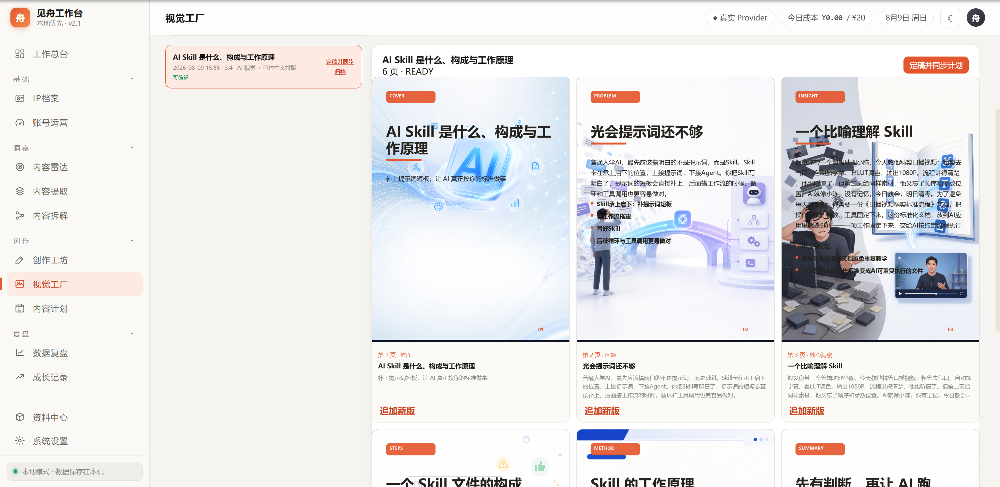
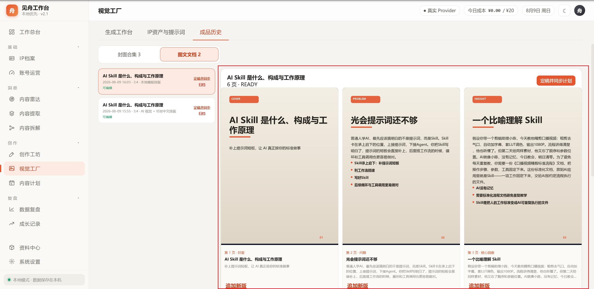
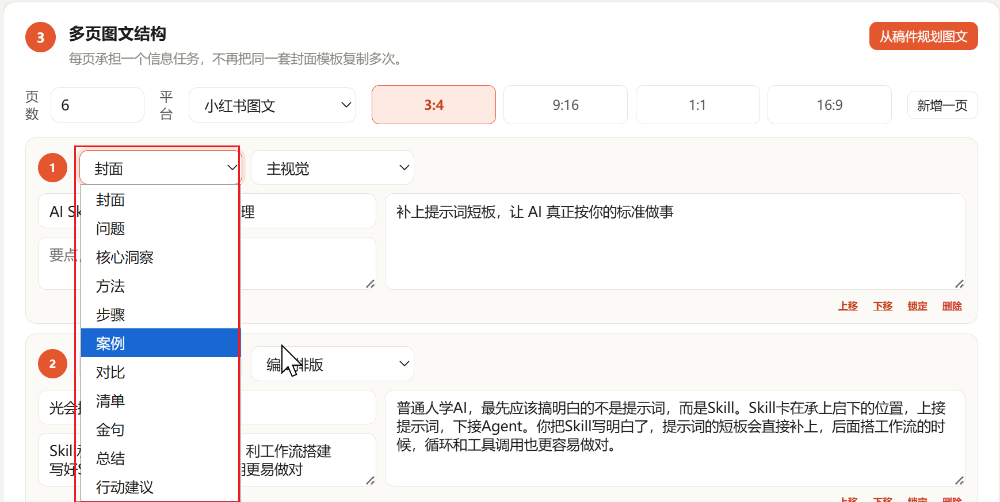
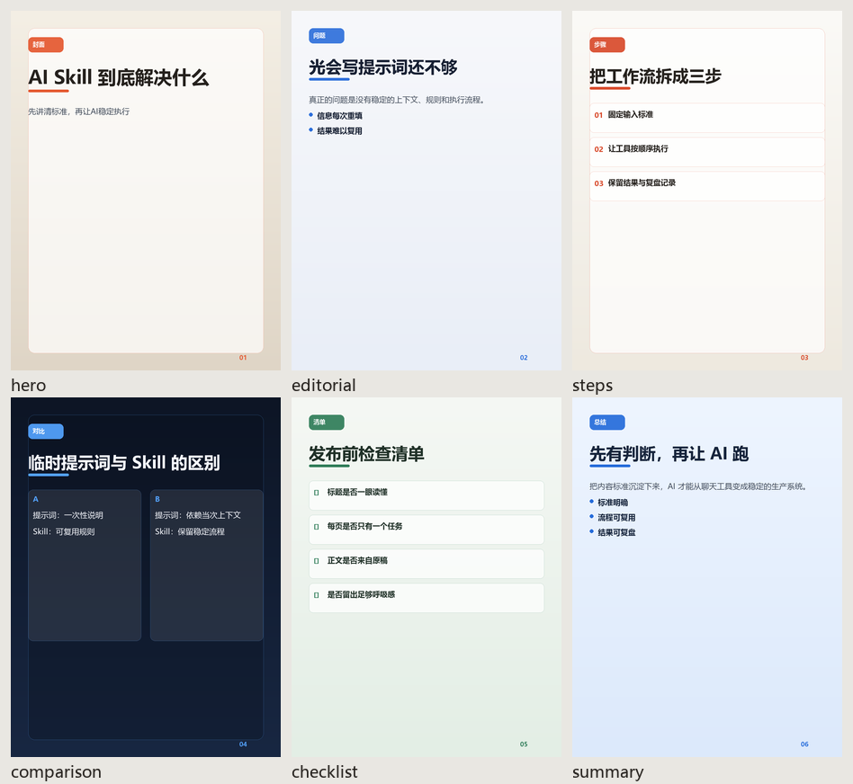

# 图文生成与编辑链路审查

## 审查范围

用户从已保存稿件进入图文笔记工作室，选择叙事结构和生成方式，生成多页图文，随后在成品历史中查看、编辑、追加新版、定稿或删除。

## 1. AI视觉与中文排版

健康度：不可用。

- AI底图包含复杂场景、人物、物件和疑似文字区域，正文又直接覆盖在底图上，阅读顺序和对比度同时失效。
- 每页信息密度没有上限，图片模型和中文排版引擎承担了重复职责。
- 修复：AI混合模式只允许模型生成无字、单焦点、低对比底图；至少保留60%连续留白。AI视觉限制在顶部视觉带，中文全部进入高对比内容面板。

## 2. 本地排版与历史预览

健康度：部分可用。

- 本地模板可读，但各页几乎只有同一种“标题+正文”结构，无法表达步骤、对比、案例和清单。
- 历史详情使用固定3:4容器，未根据文档实际比例约束预览；卡片操作区和长正文容易把详情区域拉得过长。
- 修复：模板扩展为暖色便签、清爽编辑、纸张观点、深色数据、案例绿和教程蓝图；渲染器按页面任务采用 hero、editorial、steps、comparison、checklist、quote、summary 七类版式。预览容器读取文档真实比例并限制溢出。

## 3. 结构规划与生成后编辑

健康度：入口存在，闭环缺失。

- 原规划器机械使用“封面→问题→洞察→方法……”序列，没有根据稿件类型选择叙事结构。
- “可编辑”只存在于生成前。生成后的文档详情只有预览和追加新版按钮，页面正文、角色、版式和视觉要求无法修改。
- 删除实际上是归档；已采用成品被完全阻止删除，测试数据会持续堆积。
- 修复：新增智能自适应、教程步骤、观点洞察、案例复盘、对比决策、清单指南和故事论证七种策略；生成后可编辑标题、正文、要点、角色、版式和视觉要求，并可“仅保存”或“保存并追加新版”。封面、候选合集和图文文档都可以确认删除；若已采用，会先解除项目与内容计划中的视觉关联。

## 可见性与无障碍风险

- 截图能确认原页面存在文字与背景对比不足、预览溢出、操作入口缺失等问题。
- 键盘焦点顺序、屏幕阅读器标签和200%缩放仍需在可控浏览器中继续验证；本轮没有据此声称完整WCAG合规。

## 本地渲染回归

六类长文测试均落在安全区，渲染报告 `overflow=false`。该图用于验证排版引擎，不替代真实浏览器中的页面级验收。
